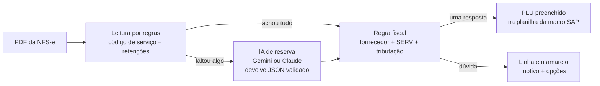

# Assistente de PLU para NFS-e (com IA)

Lê a nota fiscal de serviço (NFS-e em PDF), aplica a **base de parâmetros fiscais** e diz qual item de compra (**PLU**) usar em cada ordem de manutenção. O PLU é preenchido direto na planilha que a macro do SAP já usa. Quando a regra não consegue decidir sozinha, a linha fica marcada **com o motivo**, em vez de levar um PLU errado.

> Todos os dados em `exemplos/` são fictícios: fornecedores, PLUs, contas e notas.

## O problema

Em contas a pagar de manutenção, cada nota de serviço vira uma ordem no SAP, e cada ordem precisa do PLU certo. O PLU depende de duas coisas que estão na nota: o **código do serviço** (item da LC 116, ex.: 14.01) e a **tributação federal** que o prestador destacou (IR, PIS/COFINS/CSLL, INSS). Hoje isso é conferido nota por nota, cruzando com uma base de milhares de fornecedores. Um PLU com tributação diferente da nota só aparece depois, como **crítica no agendamento do pagamento**.

## Como funciona



A regra fiscal é a da própria base de parâmetros:

1. **Código de serviço** da nota → SERV (14.01 → `SERV1401`)
2. **Tributação da nota** → qual categoria de serviço liberada para aquele fornecedor vale. Ex.: sem retenção → *manutenção corretiva*; PCC → *preventiva sem cessão de mão de obra*; PCC + INSS 11% → *preventiva com cessão*
3. **SERV + categoria** → PLU. Se houver mais de um, decide a conta contábil preferida ou um PLU fixado no config

## Resultado com os exemplos

| Nota | Situação | Resultado |
|---|---|---|
| DANFSe nacional, sem retenção | 14.01, fornecedor tem 3 categorias | ✅ PLU de manutenção corretiva |
| DANFSe nacional, PCC + INSS 11% | 14.01 | ✅ PLU de preventiva com cessão |
| Prefeitura de São Paulo, PCC | código municipal 07498 (de-para → 14.01) | ✅ PLU de preventiva sem cessão |
| Prefeitura de São Paulo, IR 1,5% + PCC | nenhum padrão do fornecedor tem IR | ⚠️ **"vai dar crítica no agendamento"** |
| Só o texto do item, sem número | mesma tributação em 2 categorias | ✅ desempata pela descrição ("preventiva") |
| Recibo em texto corrido | as regras não acham o código | ⚠️ revisar, ou ✅ com a IA ligada |
| DANFSe, obra com INSS 11% | 07.02 | ✅ PLU de empreitada parcial |
| Fornecedor fora da base | | ⚠️ revisar |

## Onde a IA entra (e onde não entra)

A IA **só lê**, e só quando a leitura por regras não achou o código de serviço ou as retenções no PDF. Quem decide o PLU é sempre a regra fiscal, que é determinística e auditável.

| Risco | Como o projeto trata |
|---|---|
| A IA inventa um código ou um valor | O prompt proíbe inventar (campo ausente = `null`) e a resposta passa por validação (Pydantic): formato NN.NN da LC 116, CNAE recusado, valores não negativos |
| A IA responde fora do formato ou a API cai | Vira aviso e a nota vai para revisão. O lote continua |
| Dado da empresa saindo para fora | A IA vem **desligada** por padrão (`"provedor": "nenhum"`). Ligue só com um provedor aprovado pela empresa |
| Não saber de onde veio a informação | O motivo de cada linha diz quando algo foi lido pela IA (`[lido pela IA: código de serviço]`) |
| PLU errado sem ninguém perceber | Nada é preenchido na dúvida: a linha fica em amarelo com o motivo e as opções |
| A planilha da macro estragar | O resultado é uma **cópia**, com a macro VBA preservada; o original não é alterado |

## Como usar

```bash
pip install -r requirements.txt
```

### 1. Planilha (uso do dia a dia)

Dois cliques em **`executar.bat`**, ou `python escolher_plu.py`. Sem `config.json`, roda com os exemplos. Para os arquivos reais, copie `config.exemplo.json` para `config.json` e aponte:

| Campo | Para que serve |
|---|---|
| `planilha_om` | Planilha das ordens (a que a macro do SAP usa) |
| `base_fiscal` | Base de parâmetros fiscais (.xlsb ou .xlsx) |
| `pasta_pdfs` | PDFs das notas, com a ocorrência no nome |
| `baixar_notas.usar` | Baixa os PDFs que faltam pela macro [baixar_nota](https://github.com/Neres73/baixar_nota) (SAP) |
| `ia.provedor` | `"nenhum"` (padrão), `"gemini"` ou `"claude"`; a chave fica no `.env` |
| `contas_preferidas` / `plu_preferido` | Desempate quando a categoria tem mais de um PLU |
| `codigos_municipais` | De-para do código da prefeitura (ex.: São Paulo, 5 dígitos) para o item da LC 116 |

### 2. API

```bash
uvicorn api:app --reload        # documentação em http://localhost:8000/docs
```

`POST /sugerir-plu` com o PDF (`nota`) e o código SAP do fornecedor (`fornecedor`). Devolve status, PLU, motivo, opções e o que foi lido da nota.

### 3. Formulário no n8n

Importe [`n8n/fluxo_sugerir_plu.json`](n8n/fluxo_sugerir_plu.json) (*Workflows → Import from File*) e ative. Quem não usa Python abre o formulário, envia o PDF com o código do fornecedor e vê o PLU sugerido, ou o motivo para revisar. O n8n só monta o formulário e chama a API; a regra fica num lugar só.

### Ligar a IA

Copie `.env.example` para `.env`, coloque a chave (a do Gemini é gratuita em [aistudio.google.com/apikey](https://aistudio.google.com/apikey)) e mude `"ia": {"provedor": "gemini"}` no config. Use só dados fictícios ou um provedor aprovado pela empresa.

## Testes

```bash
python -m pytest
```

São 47 testes, sem chamar nenhuma API paga: a IA é trocada por um provedor falso que acerta, responde fora do formato, devolve CNAE no lugar do código e fica fora do ar. Os PDFs de exemplo são gerados por `python exemplos/gerar_exemplos.py`.

## Estrutura

```
escolher_plu.py    planilha: lê as ordens, analisa cada nota, salva a cópia com o PLU
api.py             API FastAPI (POST /sugerir-plu)
n8n/               formulário pronto para importar no n8n
plu/
  leitor_pdf.py    leitura por regras: código de serviço, valor e retenções (vários layouts)
  leitor_ia.py     IA de reserva: prompt, provedores e validação da resposta
  tributacao.py    "IR 1,5% e PCC" <-> valores retidos na nota
  base_fiscal.py   base de parâmetros (fornecedor -> categorias; SERV + categoria -> PLU)
  escolha.py       a regra que decide o PLU ou explica por que não deu
  servico.py       o caminho de uma nota (usado pela planilha e pela API)
  planilha_om.py   leitura e preenchimento da planilha da macro (VBA preservado)
  baixar.py        integração com a macro baixar_nota
exemplos/          base, planilha e notas fictícias + gerador
tests/             pytest
```

## Contexto

Trabalho em contas a pagar e automação na área de Manutenção de uma grande rede varejista, onde já automatizei com Python etapas como download de notas, geração e aprovação de pedidos. Este projeto ataca a etapa que ainda era manual: decidir o PLU de cada nota. Desenvolvido com o Claude como ferramenta de desenvolvimento.

**Gustavo Neres dos Santos** · Engenharia de Software, FIAP · [LinkedIn](https://www.linkedin.com/in/gustavo-neres-dos-santos-699046355)
