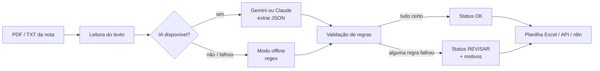

# Extrator de Notas Fiscais com IA

Lê notas fiscais (NFS-e, DANFE, PDFs de layouts variados), usa um modelo de IA generativa para extrair os dados que o contas a pagar precisa e **confere tudo com regras de negócio antes de aceitar**. O que não passa nas regras vai para revisão humana, com o motivo escrito.

> Todos os dados em `exemplos/` são fictícios: empresas, CNPJs e valores foram inventados para este projeto.

## O problema

No contas a pagar, cada nota de fornecedor precisa ser lida e digitada: fornecedor, CNPJ, número, datas, valor e itens. Os layouts mudam de prefeitura para prefeitura e de fornecedor para fornecedor, então uma automação baseada só em posição de campo ou regex quebra no primeiro modelo diferente.

A ideia aqui é dividir o trabalho:

- **A IA lê** qualquer layout e devolve os campos em JSON.
- **O código confere** se o que a IA devolveu faz sentido. Ela pode errar, e uma nota paga errada custa caro.

## Como funciona



### Regras de validação

| Regra | Por quê |
|---|---|
| Campos obrigatórios presentes (fornecedor, CNPJ, número, emissão, valor) | Sem eles a nota não entra no sistema |
| Dígito verificador do CNPJ | Pega erro de leitura da IA e erro de digitação do fornecedor |
| Soma dos itens = valor total (tolerância de R$ 0,05) | A IA às vezes pula ou duplica uma linha |
| Vencimento depois da emissão | Data trocada é erro comum em boleto |
| Emissão não pode estar no futuro | Sinal de data lida errado |
| Valor maior que zero | Evita lançar nota zerada |

### Riscos e como o projeto lida com eles

| Risco | Mitigação |
|---|---|
| A IA "inventa" um valor | O prompt proíbe inventar (campo ausente vira `null`) e as regras acima conferem o resultado |
| A IA devolve JSON quebrado ou fora do formato | Validação com Pydantic; a nota vai para REVISAR em vez de quebrar o lote |
| API fora do ar, sem internet ou cota estourada | Cai automaticamente no modo offline e marca a nota para revisão |
| Dado sensível sendo enviado para fora | Funciona 100% offline com `LLM_PROVEDOR=offline`; a chave fica em `.env`, fora do Git |
| Decisão errada sem ninguém perceber | Nada é aprovado em silêncio: cada nota sai com status e motivo na planilha |

## Resultado com os exemplos

Modo offline (só regex, sem IA):

```
Provedor: offline | 5 nota(s)

  [OK     ] nota_01_nfse_refrigeracao.txt    FrioTec Refrigeração Comercial Ltda       R$ 4.890,00
  [REVISAR] nota_02_danfe_eletrica.txt       -                                         R$ 3.126,40
              -> Campo obrigatório ausente: fornecedor
  [REVISAR] nota_03_cnpj_invalido.txt        Clean Duto Higienização de Dutos ME       R$ 3.200,00
              -> CNPJ com dígito verificador inválido: 63.840.217/0001-21
  [REVISAR] nota_04_vencimento_errado.txt    Elevar Manutenção de Elevadores Ltda      R$ 2.720,00
              -> Vencimento anterior à data de emissão
  [REVISAR] nota_05_layout_diferente.pdf     -                                         R$ 1.800,00
              -> Campo obrigatório ausente: fornecedor
              -> Campo obrigatório ausente: cnpj_fornecedor
              -> Campo obrigatório ausente: data_emissao
```

O regex acerta a NFS-e padrão, mas não entende o DANFE nem o PDF com layout livre (`nota_05`). **É exatamente aí que a IA entra**: com o Gemini ou o Claude ligado, as notas 02 e 05 passam a ser lidas. As notas 03 e 04 continuam em REVISAR, como devem, porque o erro está no documento e não na leitura. Com a IA, a nota 04 também mostra que a soma dos itens não bate com o total.

A planilha gerada tem duas abas: **Notas** (uma linha por nota, com as que precisam de revisão em amarelo) e **Itens**.

## Como rodar

```bash
git clone https://github.com/Neres73/extrator-notas-ia.git
cd extrator-notas-ia
python -m venv .venv
.venv\Scripts\activate          # Windows  (Linux/Mac: source .venv/bin/activate)
pip install -r requirements.txt
copy .env.example .env          # Linux/Mac: cp .env.example .env
```

Abra o `.env` e cole sua chave do Gemini, gratuita em [aistudio.google.com/apikey](https://aistudio.google.com/apikey). Sem chave, o projeto roda no modo offline.

### Linha de comando

```bash
python cli.py exemplos                       # usa o provedor do .env
python cli.py exemplos --provedor offline    # sem IA
python cli.py minhas_notas --saida saida/notas.xlsx
```

### API

```bash
uvicorn api:app --reload
```

Documentação interativa em http://localhost:8000/docs.

| Método | Rota | Entrada |
|---|---|---|
| `GET` | `/saude` | — |
| `POST` | `/extrair` | JSON `{"texto": "...", "arquivo": "nome"}` |
| `POST` | `/extrair/arquivo` | upload `multipart/form-data` no campo `arquivo` (.pdf ou .txt) |

### Fluxo no n8n

O arquivo [`n8n/fluxo_extrator_notas.json`](n8n/fluxo_extrator_notas.json) cria um formulário web onde a pessoa sobe a nota e já vê o resultado:

1. **Formulário** recebe o PDF/TXT
2. **HTTP Request** envia para a API (`/extrair/arquivo`)
3. **IF** separa notas `OK` de notas `REVISAR`
4. Cada caminho devolve uma tela de resposta diferente (aprovada ou motivos para revisar)

Para usar: suba a API, abra o n8n (`npx n8n`), vá em *Workflows → Import from File*, escolha o JSON e ative o fluxo. Se o n8n estiver em Docker, troque `localhost` por `host.docker.internal` no nó HTTP Request.

### Testes

```bash
python -m pytest
```

Os testes não chamam nenhuma API paga: a IA é trocada por provedores falsos para simular acerto, resposta fora do formato e queda da conexão.

## Estrutura

```
extrator/
  modelos.py    esquema da nota (Pydantic) e regras de validação
  llm.py        prompt e provedores: Gemini, Claude e offline
  extrator.py   orquestração: IA -> fallback -> validação -> status
  leitor.py     leitura de PDF e TXT
  exportar.py   planilha Excel com abas Notas e Itens
api.py          API FastAPI
cli.py          processamento em lote pela linha de comando
n8n/            fluxo pronto para importar no n8n
exemplos/       notas fictícias, incluindo casos com erro proposital
tests/          testes automatizados (pytest)
```

## Próximos passos

- Ler PDF escaneado (imagem) com o modo de visão do modelo
- Conferir o CNPJ do fornecedor contra um cadastro de fornecedores
- Comparar a nota com o pedido de compra (valor e itens) antes de liberar o pagamento

## Contexto

Trabalho com contas a pagar e automação de processos na área de Manutenção de uma grande rede varejista, onde já automatizei com Python e Playwright etapas como geração, aprovação e recebimento de pedidos. Este projeto junta essa experiência com IA generativa, usando como tema um problema que conheço de perto: a digitação e conferência de notas de fornecedores. Desenvolvido com o Claude como ferramenta de desenvolvimento.

**Gustavo Neres dos Santos** · Engenharia de Software, FIAP · [LinkedIn](https://www.linkedin.com/in/gustavo-neres-dos-santos-699046355)
